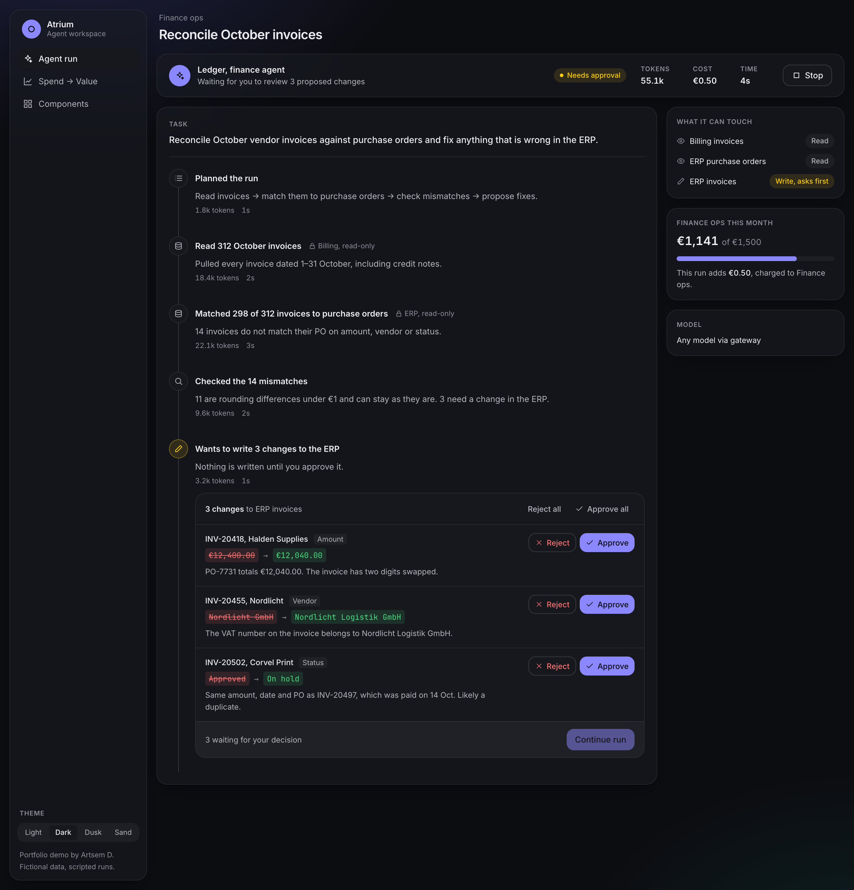
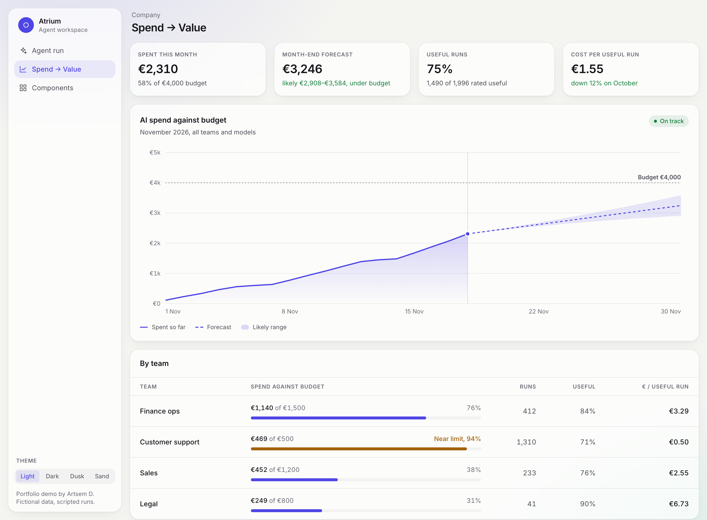

# Atrium

**An agent workspace, designed and built end to end.**
A portfolio sample by Artsem D., Design Engineer.

[Live demo](https://artsemd.github.io/atrium-agent-workspace/) &nbsp;&nbsp; [Agent run](https://artsemd.github.io/atrium-agent-workspace/#/run) &nbsp;&nbsp; [Spend → Value](https://artsemd.github.io/atrium-agent-workspace/#/spend) &nbsp;&nbsp; [Components](https://artsemd.github.io/atrium-agent-workspace/#/system) &nbsp;&nbsp; [Storybook](https://artsemd.github.io/atrium-agent-workspace/storybook/)



## Why this exists

My recent client work is under NDA, so I can't show its code or screens. Atrium recreates the same product patterns on fictional data: people hand a task to an AI agent, follow the run live, approve every change before it is written, and see what the work cost against the team's budget.

It was built in November 2026 for this portfolio. The products I shipped in production are listed at the end.

## The product problems

**Following an agent without babysitting it.**
The run is a live timeline. Each step shows what the agent read, whether the access was read-only, and the tokens and time it took. The agent's avatar breathes while it works and goes still when it is waiting for you.

**No surprises.**
Every write the agent wants to make is shown as a diff: the old value struck through, the new value next to it, and the agent's reason. You approve or reject each change, or all of them, and can undo before continuing. Nothing is written until every change has a decision, and only approved changes are applied.

**Cost only means something next to value.**
Spend → Value shows the month's spend against budget with a forecast and an honest uncertainty band, plus the share of runs people rated useful and the cost per useful run for each team.

**One source of truth for every theme.**
Four themes (light, dark, dusk and sand) come from one set of semantic tokens. The Components page shows every component in each of its states.



## Engineering decisions

| Decision                                                                                                                                                                                                                                                                                                                         | Where                                                            |
| -------------------------------------------------------------------------------------------------------------------------------------------------------------------------------------------------------------------------------------------------------------------------------------------------------------------------------- | ---------------------------------------------------------------- |
| No magic values. Colours, font sizes, layout sizes and durations are tokens (`--fg-2`, `--text-body-sm`, `--size-aside`, `--dur-fast`) mapped into Tailwind. Non-visual numbers (timings, thresholds, chart geometry) are named constants. A script fails CI on arbitrary Tailwind values, raw colours and static inline styles. | `src/styles`, `src/constants`, `scripts/check-design-tokens.mjs` |
| Types live apart from components. Props and emits are interfaces in `src/types`, components declare them with `defineProps<BaseButtonProps>()`.                                                                                                                                                                                  | `src/types`                                                      |
| Every component has stories for each of its states, rendered in all four themes from the Storybook toolbar, with the accessibility addon checking each one.                                                                                                                                                                      | `*.stories.ts`, `.storybook`                                     |
| Nothing shifts as it loads. Skeletons take the exact box of their content, the approval row keeps a fixed-width action column, and numbers use tabular figures.                                                                                                                                                                  | `BaseSkeleton.vue`, `ProposedWrites.vue`                         |
| The run is a state machine: idle, running, awaiting approval, completed, stopped. It replays a scripted run in the same shape a backend would stream over WebSocket, and a generation counter stops a cancelled run from writing into a new one.                                                                                 | `src/composables/useAgentRun.ts`                                 |
| The chart is hand-built SVG: theme-aware through CSS variables, with an accessible text summary and hover by nearest day. One chart did not need a chart library.                                                                                                                                                                | `src/components/spend/SpendChart.vue`                            |
| Accessible by default: skip link, visible focus, a live region for the agent's activity, `role="meter"` for budgets and `aria-pressed` for ratings. Reduced motion is respected.                                                                                                                                                 | throughout                                                       |

## Try a state directly

Add these to the demo URL:

- `?scene=approval` opens a run that is waiting for your decision
- `?scene=done` opens a finished, rated run
- `?theme=dark`, `?theme=dusk` or `?theme=sand` switches the theme

## Project structure

```
src/
  types/         interfaces and unions: props, emits, domain models
  constants/     named values that are not design tokens (icons, timings, thresholds, chart geometry)
  styles/        tokens.css (four themes) and main.css (Tailwind mapping)
  data/          fictional run script, spend data, samples for the Components page and stories
  lib/           pure helpers (formatting), unit tested
  composables/   useAgentRun (state machine), useTheme, useHashRoute
  components/
    base/        BaseButton, BaseBadge, BaseMeter, BaseIcon, BaseSkeleton, BaseSpinner, EmptyState
    agent/       AgentPresence, TimelineStep, ProposedWrites, RunRating
    spend/       KpiTile, SpendChart
    app/         AppSidebar, ThemeSwitcher
  stories/       Foundations: token and type scale overview
  views/         RunView, SpendView, SystemView
```

Conventions follow the Vue style guide: multi-word component names, a `Base` prefix for presentational building blocks, `<script setup>` with type-based props and emits. ESLint enforces them.

## Stack

Vue 3 with `<script setup>`, TypeScript in strict mode, Tailwind CSS 4, Vite, Vitest, Storybook 10, ESLint and Prettier.
GitHub Actions checks types, lints, checks tokens and formatting, runs the tests, builds the app and Storybook, and deploys both to GitHub Pages.

```bash
npm install
npm run dev          # app on localhost:5173
npm run storybook    # components on localhost:6006
npm run check        # types, lint, tokens, formatting, tests
npm run build
```

## Shipped work

Atrium is a sample. Products I designed and built that are live today:

- **IntusHQ**: inventory platform for web, iOS and Android ([intushq.com](https://www.intushq.com))
- **SongSelect by CCLI**: page builder made of ready-made components ([songselect.ccli.com](https://songselect.ccli.com))
- **Roofle**: instant roof quote widget with maps, e-signatures and reports ([roofle.com](https://roofle.com))
